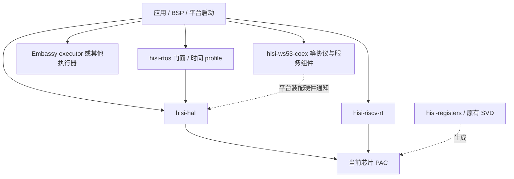

# 系统架构总览

这一篇讲的是**为什么这套 Rust 代码长成这个形状**——不是逐个 API 的清单（那是
[HAL API 总览](../reference/03-hal-api.md)），也不是逐组件的实现细节（那是
[组件深入文档](components/00-index.md)），而是把分层、所有权模型、安全边界这几件事**串成一个
能自洽解释的整体**。读完你应该能回答："如果我要加一个外设驱动，它该放在哪一层、长什么样、
为什么不能直接写寄存器。"

## 单向依赖与应用组装

HAL 面向硬件能力和已确认的 IP 行为，保留标准 blocking/async trait、外设 Future、
Waker 和取消状态机。HAL 不依赖 Embassy 时间驱动、时间队列、执行器或 RTOS。
`hisi-rtos` 按 profile 组合全局时间提供者、共用截止时间队列及闹钟重编程；纯 Embassy 应用显式
交出 TIMER/TCXO，负责中断路由、时钟配置和跨核资源交接。runtime 负责启动、链接、
异常和中断入口，不负责 Embassy 任务或资源策略。

芯片差异按三个层次区分：实例/IRQ/时钟等编译期配置在 `soc`；周期/波特率等参数由
用户配置；寄存器、副作用、停止/确认等行为由外设 IP 后端负责。只有行为一致的逻辑
才共用。不会为每个新芯片复制一套调度器，也不会把 IP 行为差异伪装成配置开关。

Embassy 时间驱动与执行器独立。`hisi-rtos/embassy` 使用 RTOS 共享定时器，分辨率为
1 ms；实验 `embassy-only` profile 不编译线程调度器，保留 TCXO 路径配置上的微秒粒度。
两者只有一处全局注册、一个选定的队列和定时器所有者。adapter 当前位于 RTOS 子仓；
未来 `hisi-rtos-embassy` 的拆分按既有 core/port/facade 规划推进。PAC、runtime、HAL、
RTOS 各自独立维护，父仓负责版本组合、QEMU 与实板验收。
详见[仓库与发布模型](08-repository-release-model.md)和
[异步与 Embassy](components/06-async-embassy.md)。

生成工具、`hisiflash`、`hisi-fwpkg`、OpenOCD、QEMU 和逻辑分析仪属于开发/验收工具，
不进入固件的普通依赖链。QEMU 通过不替代 RAM、Flash 复位及冷启动实板验收。

### 为什么 PAC 必须只有一份

有一个容易被忽视、却会在链接期炸掉的约束：**全仓库只能链接一个 PAC 实例**。
PAC 里的 `Peripherals::take()` 依赖一个 `DEVICE_PERIPHERALS` 单例静态——如果链接进两份
PAC（比如一个来自 crates.io、一个来自本地 submodule），这个静态会重复、类型也不兼容。
所以根 `Cargo.toml` 用 `[patch.crates-io]` 把 `ws63-pac` 的 registry 依赖重定向到本地
submodule。这是"单一真值"原则在构建层面的体现：不只是源码单向依赖，连**链接出的符号**
也必须唯一。

## 所有权即安全：用生命周期泛型守住外设

HAL 的核心安全模型不是运行时检查，而是**借 Rust 的类型系统把"外设被独占使用"编译期化**。
机制有三层：

1. **外设单例**：`Peripherals::take()` 在 critical-section 保护下只成功一次，
   返回一组**零大小（ZST）的外设令牌**。
2. **生命周期参数化**：每个令牌是 `Peripheral<'d>`。驱动构造器消费这个令牌
   （`Watchdog::new(wdt)`），把 `'d` 借进驱动。于是"在外设令牌还活着时不能再拿到它"
   被编译器强制——**use-after-drop 在编译期就过不了**。
3. **多实例靠类型区分**：UART/I2C/SPI/DMA 这些有多个实例的外设，用
   `PhantomData<&'d T>` + 每实例构造器（`new_uart0` / `new_uart1`）把实例编进类型，
   避免"两段代码同时以为自己独占 UART0"。

这套模式直接借鉴了 esp-hal——不是为了好看，而是因为它把**资源冲突**这类最难调试的嵌入式
bug 挡在了编译期。代价是 API 略繁（不能用统一的 `new()`），但换来的是"能编译过就不会有两个
驱动抢同一个外设"。

## `unsafe` 的边界：把它关进驱动里

裸寄存器访问**本质上是 `unsafe` 的**——你在往任意物理地址写值，编译器无从知道这是否合法。
这套架构的处理方式不是消灭 `unsafe`，而是**把它收敛**：

- PAC 层暴露的 `reg.write(|w| w.bits(val))` 是 `unsafe` 的；
- HAL 的每个驱动方法在内部 `unsafe { ... }` 这一句，外部 API 全是安全的；
- 应用层（示例）**完全不写 `unsafe`**。

也就是说，`unsafe` 被压缩成 HAL 里一条条短小、可审计的语句。一次架构评审
（见各组件文档里的"评审发现"）的隐含目标就是：让每一处 `unsafe` 都对应一个**经人核对过
寄存器手册的**写入，而不是散落在应用代码里无人负责。

## sealed trait：留扩展点，但不让外人乱接

HAL 用 crate 内部的 sealed trait（`private.rs` 里的 `Sealed` 超 trait）防止外部 crate
实现硬件限定的 signal trait，例如 `PeripheralInput` / `PeripheralOutput`。这是有意的——
这些 trait 表达的是"哪些类型是合法的引脚功能"，它们的**完整集合由硬件决定**，不该让下游随便加。
早先空的 async mode marker 和 vestigial `DmaWord` 已删除；DMA 通道/宽度约束现在由 typed token
与 `unstable` 门控承载。

## 贯穿全栈的几个决定

有几条决定不属于某一层，而是**整个栈共享的前提**：

- **`#![no_std]`**：无堆、无 `Vec`、无 `String`。需要缓冲就用定长数组。这不是洁癖——
  WS63 是资源受限的裸机环境，引入分配器会带来确定性和体积代价，而嵌入式代码几乎总能用
  定长缓冲解决。
- **目标是 `riscv32imfc-unknown-none-elf`（硬浮点 ilp32f，无原子）**，由官方
  Rust nightly 提供 builtin target。当前 rustup 还没有预编译 std 组件，所以 RISC-V
  构建使用 `rust-src` + `-Zbuild-std=core,alloc`。为什么是它而不是软浮点，见
  [硬浮点工具链](03-hardfloat-toolchain.md)。
- **无原子怎么办**：这颗核没有 A 扩展，`lr/sc/amo` 会陷入。所以 RMW 原子全部走
  `portable-atomic` 的 critical-section polyfill，`hisi-riscv-rt` 提供
  `critical-section-single-hart` 实现。这一条让 async/embassy 能在这颗核上跑——
  详见 [async 与 embassy](04-async-embassy.md)。
- **多芯片**：同一套 HAL 用 `chip-ws53` / `chip-ws63` / `chip-bs21` feature 三选一区分，
  条件编译外设模块。WS63 含 Wi-Fi 相关，BS2X 含 GADC/KEYSCAN/QDEC/RTC/TRNG 等 M1 外设；`chip-bs21` 目前需 `unstable`。

## 这套架构想达到的最终目的

把上面几条放在一起看，会发现它们都服务于同一个目标：**让"写应用"这一层完全安全、完全
`no_std`、完全不碰 `unsafe`，同时不牺牲对硬件的精确控制**。精确控制被压进 PAC（机械生成、
对着 SVD）和 HAL 的 `unsafe` 短句；安全被生命周期和 sealed trait 守住；启动和链接这些
最底层、最容易出错的事被隔离进 [hisi-riscv-rt](components/05-hisi-riscv-rt.md)。

而这套栈服务的**北极星是连接性**（WS63 的 Wi-Fi / BLE / SLE）。分层之所以值得，
是因为连接性那一层（RF blob 的 porting）最复杂、最容易把下面搅乱——清晰的分层正是
为了在引入那层巨大复杂度时，下面的 PAC/HAL/rt **不被污染**。连接性的可行性与现状见
[ws63-RF 深入文档](components/09-ws63-rf.md) 与 [HIL 框架](07-hil-framework.md)。
